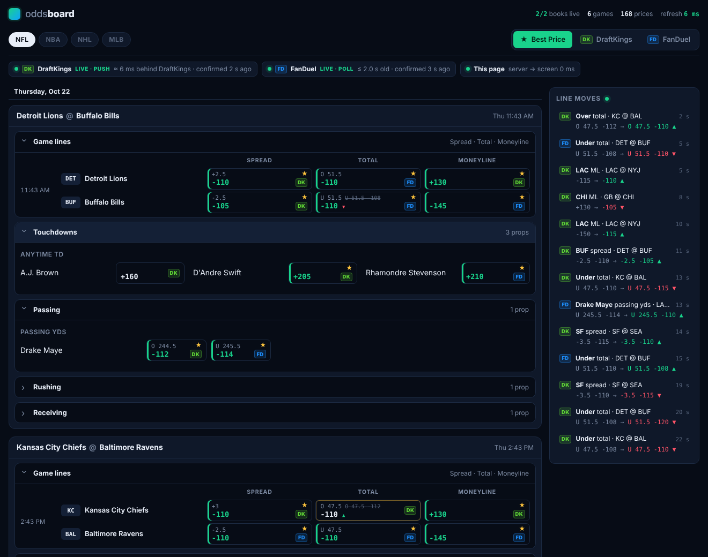

# NFL Odds Board — DraftKings vs FanDuel, live

Pregame and in-game NFL moneyline, spread and total, plus **player props** (anytime TD scorer and passing, rushing and receiving over/unders), from **DraftKings** and **FanDuel**, normalized into one model and shown side by side. A toggle switches between **Best Price** (with the book underneath), **DraftKings** and **FanDuel**. Prices update on their own as lines move, games in progress are pinned in a **Live now** band at the top, and each book's freshness is on the page.

Each game is a card: the matchup header is always visible, **Game lines** are open by default, and **Touchdowns, Passing, Rushing and Receiving** are boxed sections you open and close, each with a prop count. A **Line moves** feed lists every price change, and its history is kept on the server (Postgres when `DATABASE_URL` is set), so it survives a refresh or a deploy.

- **Live:** https://nfl-odds-board.onrender.com (Render free tier, Ohio; the first request after idle can take ~50 s to wake).
- **Stack:** Node 22 + TypeScript, two runtime dependencies (`ws`, and `pg` for the optional history database). No framework, no headless browser, no third-party odds API.



*Screenshot from `npm run demo` (mock books); the live link shows the real slate.*

## TL;DR

| Question | Answer |
|---|---|
| How is each book read? | **DraftKings:** its own push WebSocket (JSON-RPC subscribe → deltas, each stamped with DK's `createdTime`), bootstrapped and re-checked by its REST snapshot. **FanDuel:** no public push feed for sportsbook prices, so the uncached `getMarketPrices` endpoint its betslip polls, every 2 s, on top of the CDN-cached coupon page for structure. |
| How old is the number on screen? | **DraftKings:** measured from DK's own timestamps, see [Latency](#latency). **FanDuel:** FD publishes no timestamps, so it's a bound: ≤ poll interval + one round trip (≈ 2.1 s), shown on the page. |
| Browser push | Server-Sent Events. One frame per upstream change, serialized once for all viewers, sent immediately. |
| One book down? | Each book has its own state machine. The other keeps updating; the broken book's cells grey out with a banner saying how old they are. |
| Player props? | Anytime TD and over/unders from both books, matched by player and stat; see [Player props](#player-props). |
| Line history? | The server keeps recent moves and sends them with the snapshot; with `DATABASE_URL` set they're saved in Postgres and reloaded on start. See [Line history](#line-history). |
| Third book? | Implement `BookAdapter` (4 methods) and register it. Store, best price, SSE and UI are book-agnostic. |

## Run it

Requires Node 22+.

```bash
npm install
npm run demo      # the real server + adapters against local mock books — no network needed
npm run dev       # against the real books (REGION=us default; REGION=ca for Ontario)
npm test          # 40 tests, ~3 s, incl. end-to-end against the mock books (+3 on real captures, below)
npm run probe     # "can this machine reach DK and FD?" — run on your laptop and on the host
npm run capture   # record real payloads from both books into fixtures/ (then npm test checks them)
npm run audit     # 15 min: does the DK push feed miss anything vs REST?
npm run measure -- https://<your-app> 600   # watch a running board, print the latency table
npx tsx scripts/probe-props.ts              # sample DraftKings' player-prop sections (REGION=ca from Canada)
```

Open http://localhost:3000.

**Pick the region preset to match where the server runs** (both books are geo-locked):

| `REGION` | DraftKings | FanDuel | Use from |
|---|---|---|---|
| `us` (default) | `dkusnj`, `sportsbook-ws-us-nj` | `sbapi.nj.sportsbook.fanduel.com` | US hosts (Render Ohio, Fly iad) |
| `ca` | `dkcaon`, `sportsbook-ws-ca-on` | `sbapi.on.sportsbook.fanduel.ca` | Canadian IPs (local in Canada, Fly yyz) |

Every URL can be overridden individually (`DK_REST_URL`, `DK_WS_URL`, `FD_PAGE_URL`, `FD_PRICES_URL`, …) — see `src/config.ts`.

## Architecture

```
  DraftKings                                   one Node process                                 browsers
  ──────────                                   ────────────────                                 ────────
  REST snapshot ──(boot, 60 s re-check,──►  DraftKingsAdapter ─┐
  sportsbook-nash…/leagues/88808   3 s poll   DkBoard: raw events/markets/selections,  │
                   if socket down)            applies {add,change,remove} deltas        │
  Push socket ────(deltas, ~1/s)────────►     → clean quotes for touched games only     │
  sportsbook-ws-…/websocket                                                             ▼
                                                                         OddsStore (diffs everything)  ──► SseHub ── SSE ──► board
  FanDuel                                                                 + best price per slot           one frame per change,
  ───────                                                                               ▲                  serialized once,
  Coupon page ──(structure, 30 s, ETag)──►  FanDuelAdapter ────────────────────────────┘                  replay on reconnect
  sbapi…/content-managed-page               FdBoard: page = which games/markets exist,
  getMarketPrices ──(prices, every 2 s)─►     price channel overlaid on top
  smp…/getMarketPrices (uncached)
```

- **One ingestion per book**, not per tab. 1 or 1,000 viewers cost the books the same: one DK socket, one FD poller.
- **Everything becomes a delta.** DK sends deltas; FD sends full pictures. Both go through `OddsStore`, which diffs, so the browser only ever receives changes (with the previous price, for the flash and "was" display).
- **Best price is computed once, server-side**, for only the slots that changed, and shipped with the delta.
- **Clean model** (`src/core/types.ts`): `game → market (moneyline | spread | total) → side (away/home, over/under) → line + odds + book`. Games match across books by a canonical key `nfl:<ET date>:<AWAY>@<HOME>` from a 32-team registry (`src/core/teams.ts`); unknown names are never guessed.

```
src/core/       book-agnostic: types, team registry, odds, best price, store, latency
src/books/      one folder per book: adapter (transport) + normalize (shape → model)
src/server/     HTTP routes, SSE hub
public/         the board (plain HTML/CSS/JS, no build step)
scripts/        demo, mock books, probe, measure
test/           unit tests + end-to-end against mock books
```

## Getting the data

Found by watching the Network tab on each site's NFL page (on load, and while sitting on a live game) and reading their client JavaScript.

### DraftKings: push

- **Snapshot:** `GET https://sportsbook-nash.draftkings.com/api/sportscontent/{site}/v1/leagues/88808`. Returns flat `events[]`, `markets[]`, `selections[]` referencing each other by id, plus `subscriptionPartials` — the exact socket queries DK's own client subscribes with. We subscribe with those rather than hard-coding a query.
- **Socket:** `wss://sportsbook-ws-{region}.draftkings.com/websocket?format=json`, JSON-RPC `subscribe` → `subscribed` ack (carries DK's server time) → `update` frames: `{add, change, remove} × {events, markets, selections}` with `metadata.createdTime` and `websocketPublishTimestamp`. DK's site uses `format=msgpack`; `format=json` carries the same messages.
- **Why:** it is exactly what DK's site does — changes only, the moment they're published, one connection, no login. Polling REST can't beat it (and the REST response is CDN-cached anyway).
- **REST's other jobs:** bootstrap; a 60 s integrity re-check while the socket is up (any price that differs from what the deltas produced is counted as a `resyncCorrection` in `/api/metrics` — it should stay 0); and the fallback, polled every 3 s, when the socket has been down for 10 s.

### FanDuel: two polled channels

- **Structure:** `GET https://sbapi.{state}.sportsbook.fanduel.{tld}/api/content-managed-page?page=CUSTOM&customPageId=nfl&_ak=…` (`_ak` is a public constant in FanDuel's web bundle). Which games and markets exist. It sits behind CloudFront (`max-age=30`), so it can be up to 30 s old no matter how fast you poll it. Read every 30 s with `If-None-Match`; an unchanged page is a body-less 304.
- **Prices:** `POST https://smp.{state}.sportsbook.fanduel.{tld}/api/sports/fixedodds/readonly/v1/getMarketPrices` with `{"marketIds": [...]}` — the endpoint FanDuel's betslip polls. `Cache-Control: no-cache`, ~1 KB per market, no key or cookie. Batched at 70 ids (larger batches are truncated silently).
- **Why polling, and why 2 s pregame / 1 s live:** there is no public socket for FanDuel sportsbook prices (the AppSync socket in their bundle belongs to their prediction-market product). With polling, freshness = interval + RTT. FanDuel's own client polls this every 5 s; 2 s gets the pregame bound to ~2.0 s at ~1 small request/s (NFL is ~96 game-line markets → 2 batches). In-game markets move far more often, so they alone are polled every 1 s, halving their bound to ~1.0 s without doubling the load for the whole board. Going faster than that would add requests to a book that gives no rate-limit signal. Both are env vars (`FD_PRICES_MS`, `FD_LIVE_PRICES_MS`).
- If the price channel fails, the adapter falls back to the page's own prices, says so on the page, and the stated bound widens to the page's ~60 s.

## Shape of the data & matching

| | DraftKings | FanDuel |
|---|---|---|
| Delivery | Socket: **deltas only** — you keep the rest. REST: full picture. | **Full picture** every poll. |
| Teams | `participants[].venueRole` + `"DET Lions"` | `"Detroit Lions @ Buffalo Bills"` |
| Market | `marketType.name` Moneyline / Spread / Total | `MONEY_LINE`, `MATCH_HANDICAP_(2-WAY)`, `TOTAL_POINTS_(OVER/UNDER)` (+ futures to ignore) |
| Side | `outcomeType` Home/Away/Over/Under | `result.type` HOME/AWAY/OVER/UNDER |
| Line | `points` | `handicap` (0 on moneylines) |
| Odds | `trueOdds` (decimal) + `displayOdds.american` with a **Unicode minus** (`−110`) | `americanDisplayOdds.americanOdds` + `trueOdds.decimalOdds.decimalOdds` |
| Kickoff | 7 fractional-second digits | often listed a minute later than DK |

DraftKings delta gotchas, all covered by tests (`test/books.test.ts`):
- `change` objects are **partial** (a price change has no `marketId`), so they're merged onto what we hold.
- A **line move gets a new selection id** with `replacedSelectionId` and no `marketId`; we carry the old selection's fields over. Updating "by id" would silently lose every line move. Moves can also arrive as remove + add.
- A change that references something we don't know triggers a REST re-check (rate-limited) instead of a guess.
- Malformed records are dropped and counted (`invalidEntities`), never fatal.

### "Best price" across different lines

**The call: the line first, the price breaks ties.** For a side, `-3 -110` beats `-3.5 +100`; for totals, Over wants the lower number and Under the higher one. Line shoppers shop the number first, and in the NFL a half point — especially onto or off **3 and 7** — is worth more than 10 cents of juice.

One exception, so it doesn't do anything silly: between non-key numbers, if the worse line pays ≥ 20 cents more per half point (e.g. `-5.5 -105` vs `-6 +120`), the price wins. Suspended prices never win. Hovering a cell shows the other book's line and price, and the per-book views show everything (`src/core/best.ts`, `test/core.test.ts`).

## Player props

Anytime TD scorer and the main over/unders from both books, for every NFL game on the board, compared per player and stat. Live on Oct 20 (28 game entries, 14 games): DraftKings 163 TD + 288 over/under prices, FanDuel 156 + 276, and 365 props priced at both books within seconds of startup.

**Model.** No new layers, just new keys:

| | Market | Side | Line |
|---|---|---|---|
| Anytime TD | `td_anytime` | `p:<player>` | none, so Best Price is the highest payout |
| Over/under | `prop:<stat>`, e.g. `prop:passing_yds` | `p:<player>:over` / `:under` | the book's line; Best Price works like totals (Over wants the lower line) |

Stats: passing yards, TDs, completions, attempts, interceptions; rushing yards, attempts; receiving yards, receptions; rush + receiving yards (`src/core/players.ts`).

**Where each book keeps them** (both shapes taken from real responses on Oct 20, and those samples are in the tests):

| | DraftKings | FanDuel |
|---|---|---|
| Source | Its league API's sections: TD Scorers (category 1003 / subcategory 12438) and every "… O/U" section under Passing, Rushing, Receiving, found in DraftKings' own section list | Each game's event page, tabs `td-scorer-props`, `passing-props`, `rushing-props`, `receiving-props` |
| Shape | Market `<Player> <Stat> O/U`, selections `outcomeType` Over/Under with the line in `points`; TD market type 11019 | `PLAYER_X_<STAT>[_HIGH\|_MEDIUM\|_LOW]`, runners `result.type` OVER/UNDER with the line in `handicap`; TD `ANY_TIME_TOUCHDOWN_SCORER` |
| Cadence | Every section every 10 s (`DK_PROPS_MS`), one request at a time | Structure: four tabs per game every 60 s (`FD_PROPS_MS`). Prices: the same uncached price channel as game lines, pregame every 10 s (`FD_PROP_PRICES_MS`), live at the 1 s live cadence |

**Matching, and the accuracy rule.** A player key is the name with accents, punctuation and suffixes removed (`D'Andre Swift` → `dandre-swift`, `Luther Burden III` → `luther-burden`). Stats map by name. Anything that doesn't map (a new stat, a game we can't place) is left out, never guessed: a wrong match would put the wrong player's price in Best Price.

**Left out on purpose:** ladders (DraftKings "Milestones", FanDuel `ALT_` markets), first/last TD scorer and 2+ TDs, and 1st-quarter props. They're the same pattern with a line dimension, but each needs its own Best-Price rule.

**Freshness trade-off.** Hundreds of props per game, and they move less than sides and totals, so pregame props are read every 10 s. Live FanDuel props ride the 1 s live cadence. DraftKings props are fetched, not pushed: subscribing their sections on the socket is the next step (see [What I'd do next](#what-id-do-next)).

## Line history

The hub keeps the last 40 real price moves (a price or line that actually changed, not a first sighting) and sends them with the snapshot every browser gets on connect, so a refreshed page starts with recent history instead of a blank feed. With `DATABASE_URL` set, each move is also written to Postgres (`line_moves`: time, quote, previous price, as JSONB) and the newest 40 are loaded on startup, so history survives restarts and deploys. Writes are fire-and-forget, so a slow database never delays the live board, and if the database is down the board keeps running and logs the failed writes (`src/server/moves-db.ts`).

## Latency

**How it's measured.** DraftKings stamps every delta with `createdTime` (its odds engine) and `websocketPublishTimestamp` (its socket layer). The server stamps receipt. Clock skew to DK is estimated NTP-style from the subscribe round trip, then tightened from traffic (a frame can't arrive before it was published, so negative wire times nudge the estimate). The browser estimates its offset to the server via `/api/time` and measures server → screen with each frame's `emitTs`.

FanDuel publishes no timestamps, so there's nothing to measure against: the honest number is a **bound**, interval + round trip, and the page says "age ≤ 2.1 s" rather than pretending.

**Measured** (`npm run measure -- <url> 600` against the deployed app; also live at `/api/metrics`):

Measured on the deployed app (Render Ohio, Oct 14, pregame, 134 DraftKings price moves; `/api/metrics`, plus the browser side measured from Edmonton, Canada):

| Book | Phase | Stage | n | p50 | p95 |
|---|---|---|---|---|---|
| DraftKings | pregame | DK engine (`createdTime`) → our server | 134 | 98 ms | 1,068 ms |
| DraftKings | pregame | DK socket publish → our server (network) | 134 | 25 ms | 41 ms |
| FanDuel | pregame | price poll round trip | 500 | 16 ms | 21 ms |
| FanDuel | pregame | bound: 2 s interval + round trip | 500 | ≈ 2.02 s | ≈ 2.02 s |
| Both | pregame | our server → browser (Edmonton, ~100 ms RTT) | 20 | 103 ms | 331 ms |
| DraftKings | live | DK engine → our server (last 500 in-game moves at the end of Thursday Night Football, Oct 15; see the Sunday table for whole games) | 500 | 105 ms | 293 ms |
| DraftKings | live | DK socket publish → our server (network) | 500 | 34 ms | 100 ms |
| FanDuel | live | bound: 1 s interval + round trip (by design) | — | ≈ 1.02 s | ≈ 1.02 s |

The p95 of ~1 s on DraftKings is time inside DraftKings: the network leg's p95 is 41 ms, so the long tail is DraftKings occasionally holding a change before its socket publishes it, which no client can shorten. The 60 s REST re-check found 0 prices the socket had missed.

**Live games: a full Sunday (Oct 18).** `.github/workflows/sunday-latency.yml` watched the deployed app from a GitHub Actions runner in three runs covering 9:36 am to 12:59 am ET (the Sunday Night run started 44 min late, so it missed the first ~40 min of that game). Every real price move was counted, about 43,000 DraftKings and 35,000 FanDuel. Full hourly tables: [`latency/`](latency/).

| Window (ET) | DraftKings phase | Moves | DK engine → our server p50 / p95 / p99 / max | Our server → watcher p50 / p95 |
|---|---|---|---|---|
| Early: London game + 1 pm slate (9:36 am–3:21 pm) | live | 19,365 | 356 / 938 / 1,434 / 4,205 ms | 26 / 29 ms |
| Late: 4 pm slate (3:07–8:52 pm) | live | 19,674 | 223 / 883 / 1,646 / 11,111 ms | 26 / 30 ms |
| Sunday Night Football (8:59 pm–12:59 am) | live | 2,223 | 731 / 4,231 / 8,451 / 12,814 ms | 18 / 23 ms |
| All three windows | pregame | 1,789 | 60–457 / 178–1,526 ms by window | 18–26 / 21–51 ms |

What it shows:

- **The network and our server are not where the time goes.** DraftKings' socket publish → our server stayed at 17–28 ms p50 every hour (p95 22–94 ms), and our server → watcher at 18–26 ms p50. Everything above that is between DraftKings' engine stamping a price and its socket publishing it.
- **The tail did not grow with load.** The busiest hour, 4–5 pm ET with 9 live games, had a p50 of 178 ms. The worst hour was the single Sunday Night game's 9–10 pm (p50 1,458 ms, p99 10.8 s). The quiet 12–1 pm hour (1 live game) was 198 ms.
- **It is worst early in games and best late.** Sunday Night went 1,506 → 1,458 → 751 → 256 ms p50 hour by hour, and its last 500 moves were 79 / 210 ms. That matches Thursday's 105 / 293 ms, which was also an end-of-game sample. So Thursday's number is real, but it describes the end of a game, not a whole game.
- **What it means for users:** a typical in-game DraftKings price is about a quarter to three quarters of a second old when it reaches us, and occasionally several seconds. That delay is inside DraftKings, so no client can remove it, but the board can show it honestly per price.

End to end, a DraftKings change reaches a viewer at roughly DraftKings' own delay + ~25 ms (US) or ~100 ms (Edmonton).

**What was done to bring it down:**
- **Push, not poll, for DK** — the biggest lever by far. Per-update work is proportional to what changed: a delta re-normalizes only the touched game, never the board.
- **The uncached price endpoint for FD** instead of the 30 s CDN-cached page: ~30 s → ~2 s.
- **Smart polling for FD:** in-game markets every 1 s, pregame every 2 s (`FD_LIVE_PRICES_MS`, `FD_PRICES_MS`). Live markets move far more often, so they get the shorter bound without doubling the load on the whole board.
- **Server work per move is ~73 µs** (parse → apply → normalize → diff → best price → SSE frame), measured on real DK frames: DK entities are indexed by parent so a delta touches one game, and the Eastern-time date formatter is built once (constructing it per game key was 85% of the cost; 105 µs → 14 µs for apply + normalize). JSON parsing is 4 µs per frame, so a faster parser (simdjson) would buy nothing.
- **Keep-alive and compression:** FD price polls reuse a warm TLS connection (each poll lands inside Node's 4 s keep-alive window); REST and page reads ask for `br` as well as gzip. HTTP/2 isn't used: the latency path to DK is a single persistent socket, FD's two batches each already ride a warm connection, so multiplexing saves nothing measurable.
- **No batching window** on the way to the browser; each SSE frame is serialized once for all clients; `TCP_NODELAY` on; `X-Accel-Buffering: no` so proxies don't hold frames.
- **Small payloads:** deltas carry only changed quotes (a typical DK move is a few hundred bytes); the snapshot is sent once per connection.
- **Reconnects don't reload:** frames carry ids; a reconnecting browser sends `Last-Event-ID` and gets only what it missed from a 1,000-frame ring buffer.
- **Hosting near the books:** US-East (Render Ohio / Fly iad), where both books' US edges are. Where the browser is matters much less — it's one hop of ~20–80 ms.
- **What can't be reduced from outside:** time spent inside DraftKings between its engine stamping a price and its socket publishing it. That shows up as the gap between "engine → server" and "network" in the table.

## What we hit

- **DraftKings — bot protection (Akamai).** The REST host fingerprints the TLS client: `curl` and Python's default HTTP stack get `403 Access Denied` even with browser headers, while Node's built-in `fetch` is accepted. That's one reason this is Node. Requests send the headers a browser tab would (`Origin`, `Referer`, UA). Cloud IPs can also be refused on the REST host while the socket host accepts them. That's DraftKings' call to make, so the app doesn't try to get around it: the adapter shows **DEGRADED** with the 403 rather than failing silently, `npm run probe` on the host shows it before you deploy, and the fix is a host DraftKings serves normally.
- **DraftKings — geo.** Each region is a separate site (`dkusnj`, `dkcaon`, …); a Canadian IP is served the Ontario product. Configurable via `REGION`.
- **DraftKings — auth.** None: the socket accepts an empty `jwt`, REST needs no cookie, so nothing expires. If DK starts requiring a token, the subscribe isn't acked within 10 s → the socket is abandoned, the adapter falls back to REST polling, and the page says so; close code `4000` (DK's "bad params") backs off 30 s instead of hammering.
- **FanDuel — geo.** The US host refuses Canadian IPs; Canada uses the `.ca` Ontario host. `REGION=ca`.
- **FanDuel — caching.** The page's 30 s CloudFront cache is the real limit, not a rate limit — hence the price channel.
- **FanDuel — re-keyed selections.** A line move can produce a selection id only the page knows yet; an unknown id from the price channel forces an early page read.
- **Rate limits.** None hit at these cadences. 429s back off; failures back off exponentially with jitter.

## Proving it on real data

Mock books prove the plumbing; these prove the parsers and the delta engine against what the books actually send.

- **`npm run capture`** records a DraftKings snapshot, every socket frame for 60 s (`CAPTURE_SECONDS=300` for more), the FanDuel page and its prices into `fixtures/`. `test/real-fixtures.test.ts` then checks that every game maps with nothing invalid, that **replaying every captured delta ends on exactly the board a fresh read of the same state gives**, and that every FanDuel game finds its DraftKings twin by game key.
- **`npm run audit`** builds a DraftKings board from the socket alone, never re-synced, and compares it with a REST read every 5 s for 15 minutes. A price still different on the next comparison is a miss.

On the deployed app the 60 s REST re-check has found 0 prices the socket missed (`resyncCorrections: 0`), and the clock self-check shows 0 negative network samples out of 134.

The skew estimate checks itself too: `/api/metrics → books.draftkings.clockCheck` counts network samples that came out negative (a frame "arriving before it was sent"). That should sit at ~0 after the first few frames; if it climbs, the latency numbers aren't trustworthy.

## Failure handling

| What breaks | What happens | What you see |
|---|---|---|
| DK socket drops | Reconnect with backoff (0.5 → 15 s), REST poll every 3 s after 10 s down, gap-filling re-check on reconnect | DK chip: POLLING |
| DK socket silent | Ping every 15 s; reconnect after 45 s of silence | — |
| DK REST 403 / 5xx | Last good board kept; socket keeps running | Error on hover; DEGRADED if the socket is also down |
| FD price channel fails | Fall back to page prices; bound widens | FD chip: POLLING, "page only" |
| FD fully down | Last good board kept; backoff | FD chip: STALE/DEGRADED, FD cells greyed + banner. **DK unaffected** |
| No contact with a book for 30 s | Marked stale | Banner: "FanDuel is stale — last confirmed 42 s ago"; its cells greyed with STALE; it can't silently win "best" |
| Browser loses the server | `EventSource` reconnects in 1 s with `Last-Event-ID` | "Reconnecting — numbers below are frozen" |
| Unexpected payload | Bad records dropped and counted | `invalidEntities` in `/api/metrics` |

`test/e2e.test.ts` runs the real server against mock books and checks the important ones: both books boot into one board with matching game keys; a DK move reaches an SSE client; a DK line move (re-keyed selection) is followed; an FD move arrives via the price channel; **with DK fully down, FD keeps updating and DK reports stale**; DK recovers.

## HTTP API

| Route | |
|---|---|
| `GET /api/stream` | SSE: `snapshot` on connect, then `delta` (changed quotes + prev + best), `status` every 2 s (health + metrics). Supports `Last-Event-ID`. |
| `GET /api/board` | The whole normalized board as JSON (game lines, player props and the recent `moves`) |
| `GET /api/metrics` | Per-book health, counters, latency percentiles, SSE clients |
| `GET /api/time` | Server clock, for the browser's offset |
| `POST /api/refresh` | Force a full re-read of both books (rate-limited) |
| `GET /healthz` | Health check |

## Deploying

Free tiers are enough; it must be an **always-on process** (it holds the DK socket), so not Vercel/Netlify functions.

- **Render (free):** New → Blueprint → this repo. `render.yaml` sets Docker, Ohio, `/healthz`. Free instances sleep after 15 idle minutes, which would drop the DraftKings socket, so on Render the server requests its own public `/healthz` every 10 minutes (`RENDER_EXTERNAL_URL` is set by Render; `SELF_PING_MS=0` turns it off). GitHub's scheduled `keepalive.yml` is a backup only: its 10-minute schedule is best-effort and in practice ran far less often.
- **History database (optional):** in Render, New → Postgres (same region), copy its *Internal Database URL* into the web service as `DATABASE_URL`, then deploy. The table is created on first start.
- **Fly.io:** `fly launch --copy-config --no-deploy && fly deploy` (`fly.toml`: iad, 1 always-on machine).
- **Run `npm run probe` on the host first** (Render shell / `fly ssh console`). After deploying, open `/api/metrics`: both books should be `live`. If DK shows a 403, that host's IPs are refused on the REST host — pick another host or region rather than working around it.

## Above & beyond (the optional list)

| Item | Status |
|---|---|
| Show the odds moving | **Done.** A changed price flashes green (better for the bettor) or red, the previous price stays struck through beside it for a minute, and a "Latest line moves" panel lists every change from either book. |
| Latency on the page, per book | **Done.** Each book's chip says how old its numbers are right now: DraftKings "≈ N ms behind DraftKings" (its measured engine → server time plus this page's measured server → screen time), FanDuel "≤ N s old" (poll interval + round trip + server → screen), plus when each was last confirmed. Hovering a price shows when it last moved. |
| Reconnects, retries, honest staleness | **Done.** Socket reconnects with backoff, REST fallback, `Last-Event-ID` replay for the browser, per-book STALE/DEGRADED chips, greyed cells, a banner with the last-confirmed time, and stale books excluded from Best Price. |
| Props | **Done** for anytime TD and the main over/unders, both books; see [Player props](#player-props). |
| Alt lines, other leagues | **Designed, not built** (see below). |
| A third book, or ten; where AI helps | **Written up** in the next section. |

**Alt lines and other leagues: what it takes.** Neither is an architecture change; the adapters, store, best-price and SSE layers already handle any market keyed by game, market and side, as player props showed. Each needs parsers checked against real payloads first.

- **Other leagues:** DraftKings is the same endpoints with a different league id (NBA 42648, NHL 42133, MLB 84240) and subscription; FanDuel is the same page with `customPageId=nba|nhl|mlb`. Needed: a team registry per league (nicknames are not unique across leagues: Giants, Cardinals, Rangers), a `league` field in the game key, market-name aliases ("Puck Line", "Run Line"), one adapter instance per book × league, and a league switch in the UI.
- **Alt lines:** a market gets a `line` dimension in its key so several lines per side can coexist; DraftKings alt spreads/totals come from their own subcategory subscription, FanDuel from its alternate market types. Best price then compares like-for-like lines only.
- **More props:** ladders, first TD scorer and quarter props use the same keys plus a line or position dimension; other leagues need a player registry per league.

**Hosting, as a future improvement:** the live site runs on Render's free tier, which sleeps after 15 idle minutes; the server pings its own public URL to stay awake. For production: an always-on instance (Render Starter, $7/month, or a small VM) in the region measured closest to the books, so the first viewer never waits for a cold start and the DraftKings socket is never dropped.

## Scaling: a third book, or ten

- **A third book** = a folder in `src/books/` implementing `BookAdapter` (`start`, `stop`, `health`, `refresh`, `stats`) and emitting snapshots or deltas in the clean model, plus its team spellings in `teams.ts` if they're unusual. Nothing else changes: the store, best price, SSE and UI are keyed by book.
- **Ten books / many leagues:** move each adapter into its own worker (one per book × league) publishing normalized deltas to Redis/NATS; the web tier just fans out. Workers run on hosts each book accepts, which also decouples geo from where the site is served. Add history (ClickHouse/Timescale) off the same stream.
- **Entity matching** is what stops scaling by hand: nicknames are unique in the NFL but not across leagues (Giants, Cardinals, Rangers). A canonical entity store with per-book alias tables, where a fuzzy matcher proposes and a human approves, keeping the rule *never guess*.
- **Where AI helps:** (1) reconnaissance — reading a book's minified bundle for API hosts, auth, polling constants and the endpoint the client uses when it really cares about a price is exactly how FanDuel's price channel is found, and an agent can draft that brief from a HAR + bundle for a human to verify; (2) scaffolding an adapter + tests from captured payloads; (3) schema-drift watch — diff live payload shapes against fixtures nightly and open a PR when a field moves; the `invalidEntities` / `unresolved` counters are the alert signals; (4) entity resolution proposals. Not for the measurements — those come from scripts so they can be re-run, not believed.

## What I'd do next

With more time, in this order:

1. **Full Sunday slate: done (Oct 18).** It's measured above, and the delay sits inside DraftKings, worst early in games and in the standalone prime-time game, not under load. Next: find out why DraftKings holds early-game prices by splitting the delay by market type (moneyline, spread, total, quarter markets) to see which markets DraftKings holds, and showing each price's age on the board so users can see it.
2. **Who moved first.** When both books change the same market, record which moved and how many milliseconds earlier. Over a Sunday this shows which book leads on which markets, and it gives a real estimate of FanDuel's delay, which today is only a bound because FanDuel publishes no timestamps. The store already sees every change with a receive time, so this is a small table plus a panel on the page.
3. **Push DraftKings props, then the rest of the prop menu.** Subscribe DraftKings' prop sections on the same socket as game lines, bringing props from a 10 s fetch to the ~100 ms game lines get, with engine timestamps. Then ladders, first TD scorer and quarter props.
4. **Line history and a no-vig fair line.** Moves are already kept (Postgres when configured); next is the opening line, current line and a small trend per market. From the two books' prices, remove the bookmaker margin to get a fair price, and flag any price better than fair. That turns a price comparison into the start of edge detection.

After that:

- **Coverage:** alt spreads and totals, player props, first-half lines, other leagues (same endpoints, new league id and team registry), and more books, each as one new adapter.
- **Production setup:** one worker per book publishing to Redis Streams, Prometheus/Grafana alerts for stale books and latency jumps, and an always-on host near the books.
- **Resilience to book changes:** nightly checks of live payload shapes against saved samples, and msgpack on the DraftKings socket (what its own site uses) as a fallback if `format=json` goes away.
- **Product:** alerts ("tell me when this hits -3"), a mobile layout, and one-click links to the game on each book.
